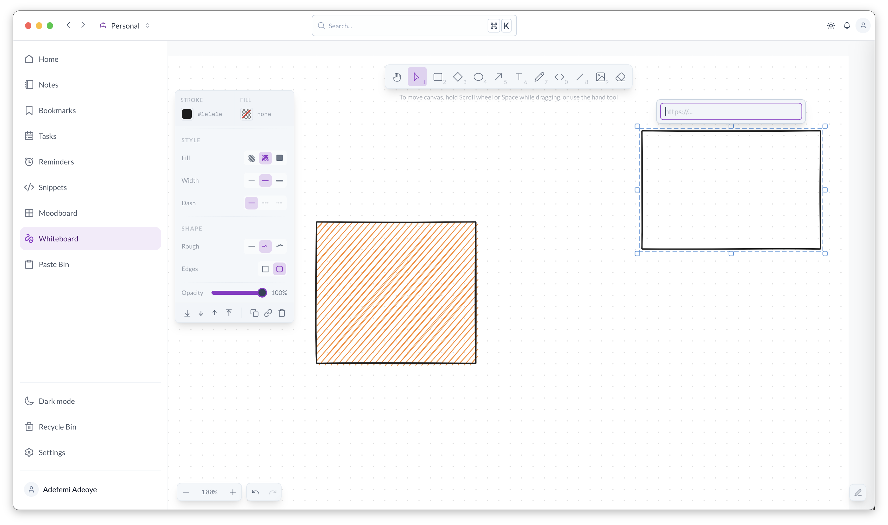

# Daily

**A customizable personal workspace for planning, organizing, and getting things done.**



Daily is a personal productivity application designed to help you organize your day, manage information, and stay focused. Built for desktop with Nuxt and Tauri, it combines a modern interface with local-first storage and a foundation for AI-assisted productivity.

## Features

- **Daily Planning** — Organize tasks, priorities, and routines.
- **Personal Workspace** — Customize your productivity environment.
- **AI Assistance** — Foundation for intelligent planning and recommendations.
- **Local-First** — Store data locally with SQLite.
- **Desktop Native** — Lightweight cross-platform application powered by Tauri.
- **Internationalization** — Multilingual support.

## Tech Stack

| Layer | Technology |
|---|---|
| Framework | Nuxt 4 + Vue 3 |
| Language | TypeScript |
| Desktop | Tauri v2 + Rust |
| UI | Nuxt UI + Tailwind CSS |
| State | Pinia + persisted state |
| Database | SQLite via Tauri SQL |
| i18n | @nuxtjs/i18n |
| Package Manager | pnpm |

## Getting Started

### Prerequisites

- Node.js
- pnpm
- Rust and Cargo
- Tauri system dependencies

### Installation

```bash
git clone https://github.com/opeolluwa/daily.git
cd daily
pnpm install
```

### Development

```bash
pnpm dev
pnpm tauri dev
```

## Documentation

- [Running & Development](docs/running.md)
- [Building](docs/building.md)
- [Database](docs/database.md)

## Roadmap

- Offline AI assistance
- Intelligent daily planning
- On-device speech recognition and synthesis
- Notes, bookmarks, and snippets
- Reminders and workflow automation

## Credits

[excalidrawNuxt](https://github.com/alexanderop/excalidrawNuxt) for project inspiration and reference.

## License

MIT — see [LICENSE](LICENSE).